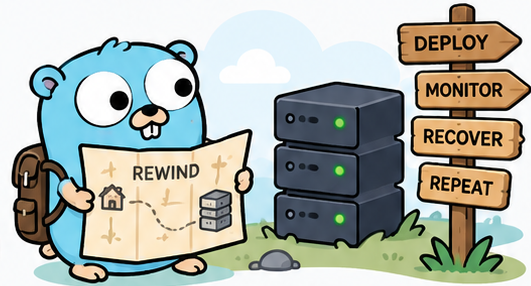

<div align="center">
  

  # REWIND

  **Deploy. Monitor. Recover. Repeat.**

  A lightweight, self-healing home server manager written in **Go**.

  `Go` · `Docker` · `CLI` · `Monitoring` · `Backups`

  **Status: Early development — the features and commands below are planned.**
</div>

## Why REWIND?

A home server is fun to build, but much less fun to rebuild after something breaks.

**REWIND** aims to make a homelab reproducible: describe your services in a file, deploy them, detect failures, and restore your setup on another Linux machine when needed.

The goal isn't to replace Kubernetes. It's to learn how reliable infrastructure works by building a small, understandable tool.

## Planned features

- **Declarative deployment** — Define services in a simple YAML file.
- **Concurrent health checks** — Monitor services using Go goroutines.
- **Self-healing** — Detect failed containers and attempt safe recovery.
- **REST API** — Inspect services and events remotely.
- **Backup & restore** — Save configuration and persistent data, then test recovery.

## How it works

```text
      rewind.yaml
           |
           v
    +--------------+
    |  REWIND CLI  |
    +--------------+
           |
           v
    +--------------+      +----------------+
    |  Reconciler  |----->| Docker runtime |
    +--------------+      +----------------+
           |
     +-----+------+
     |            |
     v            v
 Health checks   Backups
     |
     v
 Recovery actions
```

## Example

A proposed `rewind.yaml`:

```yaml
services:
  - name: website
    image: nginx:alpine
    ports:
      - "8080:80"
    healthcheck:
      url: http://localhost:8080
      interval: 30s
```

The planned CLI should make everyday operations straightforward:

```bash
rewind deploy                 # Apply the configuration
rewind status                 # Check service health
rewind backup                 # Create a backup
rewind restore backup.tar.gz  # Restore on a fresh machine
```

> These commands illustrate the intended interface; they are not available yet.

## Roadmap

- [ ] **01 — Service manager:** Read YAML and manage containers.
- [ ] **02 — Health monitor:** Run concurrent health checks with retry policies.
- [ ] **03 — Control plane:** Add a REST API and SQLite event history.
- [ ] **04 — Reconciler:** Keep desired and observed states in sync.
- [ ] **05 — Recovery:** Back up data and verify restoration on a clean host.
- [ ] **06 — Polish:** Add tests, CI, documentation, and a demo.

## Built to explore Go

The project is a practical playground for **goroutines, channels, interfaces, contexts, `net/http`, streaming I/O, testing, and the race detector** — applied to real infrastructure problems.

## Contributing

Ideas, bug reports, and contributions are welcome as the first implementation takes shape. For now, the roadmap above is the development plan.

<div align="center">
  

  <sub>Small project. Big systems lessons.</sub>
</div>
